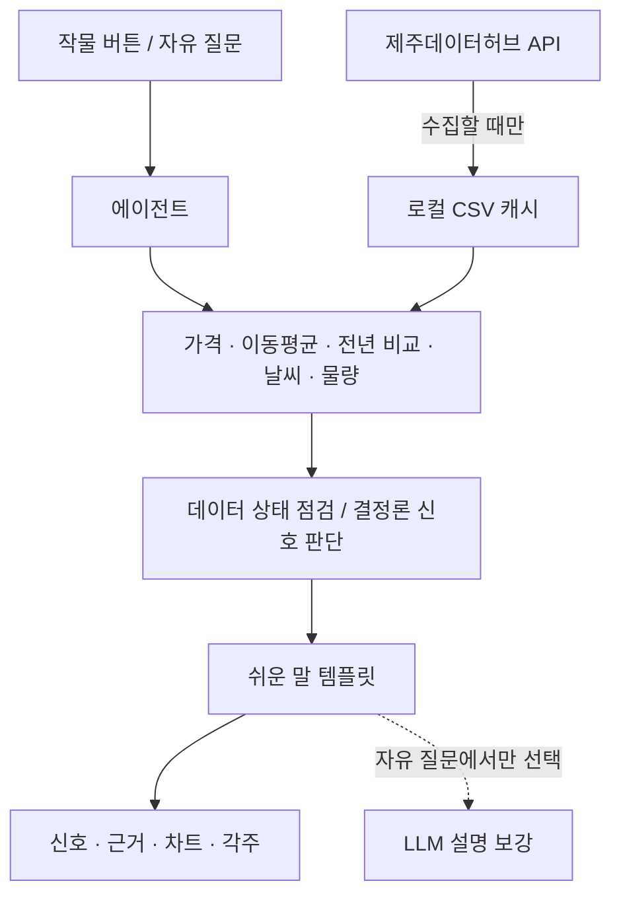

# 출하 신호등 · 제주 월동채소 편

[](https://github.com/rokmc1893/jeju-shipping-signal/actions/workflows/ci.yml)


> 작물 버튼 하나로 도매 시세와 비교 근거를 읽는 농가용 의사결정 지원 도구다.
> 전국 공영도매시장 거래 자료를 사용하며, 가격 예측이나 실제 농가 수취가를 제공하지 않는다.

당근·무·양배추를 중심으로 마늘·양파까지 조회한다. 최근 가격·이동평균·작년 동기 비교를 규칙으로 계산하고, **출하 참고 / 관망 / 주의**로 표시한다. 큰 글씨·읽어주기·물량 환산·인쇄·키오스크 기능을 제공한다.

## 현재 상태

| 영역 | 확인한 상태 |
| --- | --- |
| 계산·판단·에이전트 | 로컬 회귀 테스트 34개 통과다. 합성 자료와 HTTP API로 검증했다. |
| 프론트 | 타입 검사·프로덕션 빌드 성공이다. 데스크톱과 모바일 390px에서 일부 사용자 경로를 확인했다. |
| CI | Windows·Linux, Python 3.10/3.12 테스트와 프론트 빌드·의존성 검사를 실행한다. 위 뱃지에서 최신 결과를 확인한다. |
| 실데이터 | 2026-11-15 점검 당시 기본 CSV 캐시는 비어 있었다. 실제 5품목 검증은 아직 남아 있다. |
| 제출물 | 기획서 원본 확보·데이터 활용 명세·결과 설명자료·최종 ZIP 검증이 남아 있다. |

상세 우선순위는 [현재 점검 결과](docs/READINESS.md), 이전 설계와 결정 기록은 [인계 문서](HANDOVER.md)를 참조한다.

## 실행

Python 3.10 이상이 필요하다. 첫 프론트 빌드에는 Node.js 22 LTS와 npm이 필요하다. 의존성 설치와 실데이터 최초 수집에는 인터넷을 사용한다.

### macOS / Linux

```bash
python3 -m venv .venv
source .venv/bin/activate
python -m pip install -r requirements.txt
cp .env.example .env
# .env의 JEJU_HUB_PROJECT_KEY에 본인 키를 입력한다.
./start.sh
```

### Windows

압축을 풀거나 저장소를 내려받은 뒤 `start.bat`을 실행한다. 처음 만들어진 `.env`에 본인 프로젝트 키를 저장하고 다시 실행한다. 세부 단계는 [설치·사용 매뉴얼](docs_install_manual.md)에 있다.

실행 스크립트는 필요한 의존성을 설치하고 프론트를 빌드한다. 기본 거래 캐시가 없으면 거래 자료를 수집한 뒤 [로컬 화면](http://127.0.0.1:8000)을 연다. 최초 수집은 수십 분 걸릴 수 있다. 기상 자료는 아래 명령으로 별도 수집한다.

```bash
python scripts/collect.py --no-weather       # 거래 통계 증분 수집
python scripts/collect.py --weather-only     # 기상 자료 수집
python scripts/check_api.py                  # API 품종·최신일 등 재확인
```

기상 예산은 현재 **실행당** 제한이다. 같은 날 반복 실행한 누적 사용량과 재시도 횟수는 아직 쿼터 제한에 합산하지 않는다. 수집 전 허브 사용량을 확인한다.

### 키 없이 화면 확인

실데이터와 분리한 폴더를 사용한다. 아래는 macOS/Linux 예시다.

```bash
DATA_DIR=outputs/demo/cache python scripts/demo_data.py
npm --prefix frontend ci
npm --prefix frontend run build
DATA_DIR=outputs/demo/cache LLM_PROVIDER=none python -m uvicorn app.main:app --app-dir backend --port 8000
```

합성 자료는 화면과 응답 각주에 표시한다. 실데이터 폴더에 합성 자료를 생성하는 작업은 거부한다. Windows에서는 명령 실행 전에 `set DATA_DIR=outputs/demo/cache`를 사용한다.

## 동작 구조



- 버튼 경로는 LLM 설정과 관계없이 호출 0회다. 자유 질문의 의도 추출·설명만 LLM을 선택적으로 사용한다.
- 조회 시 허브 API를 호출하지 않는다. 캐시와 빌드가 준비되면 핵심 조회는 로컬에서 동작한다.
- 한국어 읽어주기는 운영체제의 한국어 음성 설치 상태에 따라 다르다. 음성 인식은 브라우저와 인터넷 연결이 필요하다.
- 휴장일은 가격 0원으로 계산하지 않고 마지막 거래일로 전환한다.

## 신호 규칙

| 조건 | 충족 기준 |
| --- | --- |
| 가격 수준 | 최근 가격이 30거래일 평균보다 높다. |
| 단기 추세 | 7거래일 평균이 직전 7거래일 평균보다 1% 넘게 올랐다. |
| 전년 비교 | 작년 동기 ±3일 평균보다 낮지 않다. |

3개 충족이면 초록, 1~2개면 노랑, 0개면 빨강이다. 자료가 부족하거나 판단할 수 없는 조건이 2개 이상이면 노랑으로 표시한다. 거래량과 날씨는 보조 메모이며 색을 바꾸지 않는다. 실제 기준은 [품목 설정](config/items.yaml)과 화면의 ‘왜 이 색인가요?’에 공개한다.

## 데이터와 한계

| 데이터 | 출처·용도 | 제약 |
| --- | --- | --- |
| 농산물 품종별 일일 거래 통계 · 1361 | 제주데이터허브 / 가격·거래량·거래금액 | 전국 시장 기준이며 산지 구분이 없다. |
| 농산물 품종별 일일 거래 정보 · 1362 | 제주데이터허브 / 시장별 비교 | 하루 10행 표본 제한으로 기능을 기본 비활성화했다. |
| 일별 기상 정보 · 579 | 제주데이터허브 / 과거 날씨 패턴 | 인계 당시 갱신 지연이 관찰됐다. 최신 날씨로 해석하면 안 된다. |
| 기상관측소 정보 · 578 | 제주데이터허브 / 관측소 조회 | 실제 수집·사용 범위를 제출 명세에 확정해야 한다. |

원천은 aT 도매유통정보시스템과 기상청이다. API는 한 번에 최대 10행을 반환하는 것으로 인계돼 있어 기간 분할과 재시도를 사용한다. 이용조건·캐시 재배포 허용 여부는 제출 전에 원문으로 확인해야 한다. 데이터목록 xlsx와 API 키는 공개하지 않는다.

상자·망 무게는 아직 외부 규격 확인 전이다. 화면에 환산 기준을 표시하며 `unit.verify: false`로 둔다. 규격 확인 후에만 `true`로 바꾼다. 날씨와 가격의 단순 비교는 계절·물량 등의 영향을 통제한 인과 분석이 아니다.

## 검증과 개발

```bash
python -m pip install -r requirements-dev.txt
python -m pytest backend/tests -q
npm --prefix frontend ci
npm --prefix frontend run build
npm --prefix frontend audit --audit-level=moderate
```

테스트는 실제 키나 허브 호출 없이 합성 자료·가짜 LLM·임시 캐시로 실행한다. 차트 번들 500kB 경고와 일부 라이브러리 사용 중단 예고는 남아 있다. Windows CI 통과는 센터 PC에서 직접 설치·음성·인쇄까지 검증한 결과를 대신하지 않는다.

| 경로 | 역할 |
| --- | --- |
| `backend/app/` | 설정·API 클라이언트·캐시·도구·판단·의도·LLM·HTTP API다. |
| `backend/tests/` | 계산·판단·경로·입력 검증 회귀 테스트다. |
| `frontend/src/` | React·TypeScript 화면과 차트·음성 기능이다. |
| `config/` | 데이터셋 매핑·품종·단위·판단 규칙이다. |
| `scripts/` | API 점검·실데이터 수집·합성 자료 생성이다. |
| `docs/` | 점검 결과·Claude 전달용 프롬프트다. |

## AI·오픈소스 사용

선택 가능한 LLM은 OpenAI 호환 API 또는 Ollama다. `LLM_PROVIDER=none`이 기본이며 버튼 조회에는 모델이 필요 없다. 모델명과 실제 사용 범위는 제출 시 실행 설정에 맞춰 기록한다. 생성 설명은 프롬프트로 제한하지만 숫자·문장 일치의 사후 검증은 아직 구현하지 않았다.

주요 라이브러리는 pandas, NumPy, PyYAML, FastAPI, Uvicorn, Pydantic, React, TypeScript, Recharts, Vite다. 개발 검증에는 pytest와 httpx를 사용한다. 코드 작성·검토와 문서 정리에 Claude·Codex의 도움을 사용했다.

대회 인계 문서에 기재된 결과물 권리 조건이 있어 임의의 오픈소스 라이선스를 부여하지 않았다. 공개 저장소라는 사실만으로 소스·데이터의 재배포 권한을 뜻하지 않는다.
